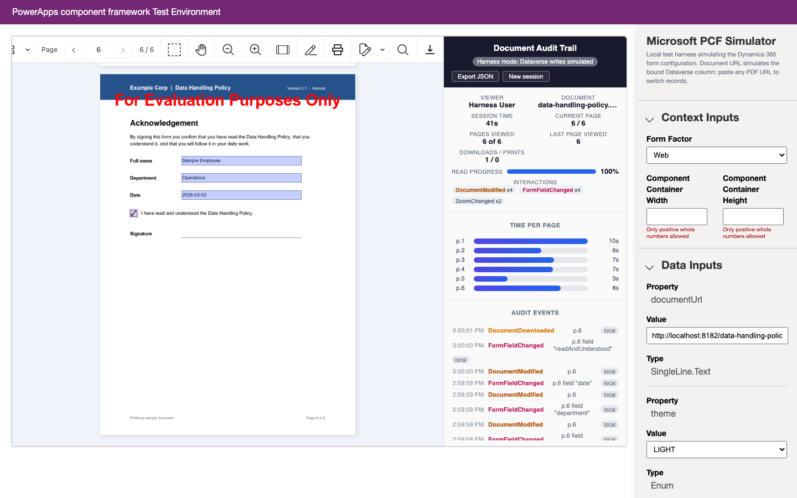
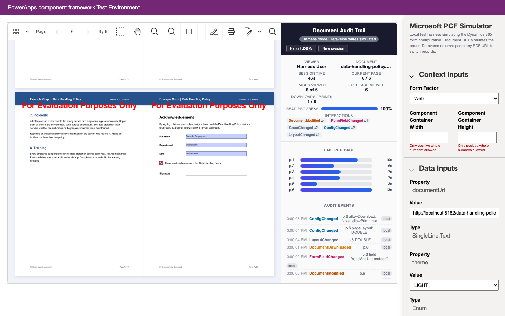

# Nutrient Dynamics 365 PDF Viewer with Audit Trail

A Nutrient.io demo of a Power Apps component (PCF control) that shows PDF documents in Microsoft Dynamics 365 forms with the Nutrient Web SDK and records who read which document, page by page, in a Dataverse table.



1. **Control.** A standard PCF control is bound to a text or URL column of the record that holds the document location. It mounts the Nutrient Web SDK viewer next to an audit panel.
2. **Viewer.** The Web SDK is loaded at runtime from the Nutrient CDN, so the control bundle stays small (under 50 KB). The CDN domain is declared in the manifest (`external-service-usage`).
3. **Events.** The control subscribes to the viewer events (page changes, zoom, annotations, comments, bookmarks, form fields, signatures, search, text selection, undo and redo) and replaces the stock download and print buttons with instrumented ones.
4. **Session tracking.** `AuditTracker.ts` turns these raw events into typed audit events: who opened which document and when, the pages viewed, the time spent on each page (paused while the browser tab is hidden), the last page, the read progress, downloads and prints. Closing the document emits `DocumentClosed` and a `SessionSummary`.
5. **Storage.** `Sinks.ts` writes one Dataverse row per event with `context.webAPI.createRecord`. In the local test harness there is no Dataverse, so the writes are simulated and flagged `local`.
6. **Maker configuration.** Theme, page layout, download, print and read-only are control properties set by the form designer. They apply live, and every change after load is itself recorded as `ConfigChanged`.

The audit panel makes the trail visible for the demo. In production it can be removed, and the trail read through model-driven views or Power BI over the audit table.

## What is recorded

| Requirement | How it is captured |
|---|---|
| User who opened the document | `context.userSettings` (Dataverse user id and name), on every event |
| Document viewed | Document name and URL, on every event |
| Open and close times | `DocumentOpened` and `DocumentClosed` |
| Page navigation | Viewer event `viewState.currentPageIndex.change`, recorded as `PageViewed` and `PageLeft` |
| Pages viewed in a session | Set of visited pages, in `SessionSummary` |
| Last page viewed | Tracked live, in `SessionSummary` |
| Time per page | One timer per page, paused while the tab is hidden (`ViewPaused`, `ViewResumed`) |
| Total viewing time | Sum of the time per page, in `DocumentClosed` and `SessionSummary` |
| Downloads and prints | Instrumented toolbar buttons: `DocumentDownloaded`, `DocumentPrinted` |
| Read progress | Pages viewed divided by page count, in `SessionSummary` and in the panel |

Other interactions are recorded too:

| Interaction | Audit events |
|---|---|
| Zoom | `ZoomChanged` (with the zoom level) |
| View | `SidebarChanged`, `LayoutChanged`, `ScrollModeChanged`, `InteractionModeChanged` |
| Annotations | `AnnotationCreated`, `AnnotationUpdated`, `AnnotationDeleted`, `AnnotationSelected` |
| Comments | `CommentAdded`, `CommentUpdated`, `CommentDeleted` |
| Bookmarks | `BookmarkAdded`, `BookmarkUpdated`, `BookmarkDeleted` |
| Forms | `FormFieldChanged` (with the field name), `FormSubmitted` |
| Signatures | `SignatureAdded` |
| Search | `SearchPerformed` (with the term and the number of hits) |
| Text | `TextSelected` (with a snippet), `TextCopied` |
| Editing | `DocumentModified`, `ActionUndone`, `ActionRedone` |
| Configuration | `ConfigChanged` |

Each subscription is wrapped in `try`/`catch`: an event that the loaded SDK version does not have is skipped instead of breaking the control. Annotation events carry the full annotation as InstantJSON (type, page, bounding box, colours, author, timestamps): in the panel behind the **parameters** link of the event, in Dataverse in the `demo_detail` column.

## Prerequisites

- Node.js 20 or later and npm
- Chrome or Edge for the test harness. The Web SDK does not start in Electron-based web views.
- Internet access: the Web SDK is loaded from `cdn.cloud.pspdfkit.com`
- To package and deploy: the .NET SDK (for the solution project), the Power Platform CLI (`pac`), and a Dynamics 365 or Power Apps environment with Dataverse
- To regenerate the sample document only: Python 3.9 or later with `reportlab`

## Settings

The control runs in the browser of the Dynamics 365 user, so it has no environment variables. Its settings are constants at the top of `NutrientPdfViewer/index.ts`. The license key is empty in this repository.

| Setting | Purpose | Default |
|---|---|---|
| `LICENSE_KEY` | Nutrient Web SDK license key, set before packaging | empty = evaluation mode |
| `AUDIT_TABLE` | Logical name of the Dataverse audit table | `demo_documentauditevent` |
| `SDK_URL` | Web SDK script on the Nutrient CDN | `.../pspdfkit-web@1.10.0/nutrient-viewer.js` |
| `DEFAULT_DOCUMENT` | PDF opened when the bound column holds no URL (test harness) | a public sample PDF of the pdf.js project |

| Environment variable | Purpose | Default |
|---|---|---|
| `SAMPLES_PORT` | Port of the local sample server (`npm run samples`) | `8182` |

In evaluation mode the viewer shows an evaluation watermark on every page. Everything else works.

## Build and run

The control runs locally in Microsoft's PCF test harness. No Dynamics 365 environment is needed.

```bash
npm install
```

```bash
npm run build
```

In a second terminal, serve the sample document with CORS headers:

```bash
npm run samples
```

Then start the harness:

```bash
npm run start:watch
```

The harness opens <http://localhost:8181>.

## Using the app

1. The control opens the default document. In the harness sidebar, under **Data Inputs**, set the **documentUrl** value to `http://localhost:8182/data-handling-policy.pdf`. This simulates the bound column changing, as when another record is opened: the current audit session is closed and a new one starts. Any PDF URL that allows CORS works.
2. Read the document: page through it, zoom, search. The panel shows the session time, the current page, the read progress and the time spent on each page. Each event is listed under **Audit events**.
3. On the last page, fill in the acknowledgement form. Each field change is recorded as `FormFieldChanged` with the field name.
4. Click the download button of the toolbar. `DocumentDownloaded` is recorded before the file is saved.
5. In the harness sidebar, change **pageLayout** to `DOUBLE` and **allowDownload** to `false`. The viewer changes at once, the download button disappears, and both changes are recorded as `ConfigChanged`.

   

6. Click an event or a time-per-page bar to jump to that page. **Export JSON** downloads the audit log of the session, in the form that is written to Dataverse. **New session** closes the session (`DocumentClosed` and `SessionSummary`) and starts a new one.

The harness sidebar is relabelled **Microsoft PCF Simulator** by the control, only outside Dataverse, to make its purpose clear in a demo.

## Control properties

| Property | Usage | Effect |
|---|---|---|
| `documentUrl` | bound | Text or URL column that holds the PDF location. A new value closes the audit session and opens a new one. |
| `theme` | input | Light or dark viewer theme (light by default). A change reloads the viewer and starts a new session. |
| `pageLayout` | input | Single or double page layout |
| `allowDownload` | input | Shows or hides the audited download button |
| `allowPrint` | input | Shows or hides the audited print button |
| `readOnly` | input | Disables the annotation and form tools |

## Dataverse audit table

Create a table with the logical name `demo_documentauditevent` and these columns:

| Column (logical name) | Type |
|---|---|
| `demo_name` | Text (primary column) |
| `demo_sessionid` | Text |
| `demo_eventtype` | Text |
| `demo_userid` | Text |
| `demo_username` | Text |
| `demo_documentname` | Text |
| `demo_documenturl` | Text |
| `demo_pagenumber` | Whole number |
| `demo_pagecount` | Whole number |
| `demo_durationseconds` | Decimal |
| `demo_detail` | Multiline text (JSON payloads: annotations, session summary) |
| `demo_eventtimestamp` | Text (ISO 8601) |

The `demo_detail` column of a `SessionSummary` row holds the aggregate as JSON: pages viewed, last page, time per page, read progress, download and print counts, interaction counts. Reports can use the raw event stream or only the summary rows. If your publisher uses another prefix, rename the columns in `Sinks.ts` and the table in `AUDIT_TABLE`.

## Deploy to Dynamics 365

1. Create the audit table above, in the Power Apps maker portal or in a solution.
2. Set `LICENSE_KEY` in `NutrientPdfViewer/index.ts`.
3. Push the control to your environment during development:

   ```bash
   pac auth create --environment <environment-url>
   ```

   ```bash
   pac pcf push --publisher-prefix demo
   ```

   Or build the solution package, `SolutionPackage/bin/Release/SolutionPackage.zip` (managed), and import it:

   ```bash
   dotnet build SolutionPackage/SolutionPackage.cdsproj -c Release
   ```

4. On the form, add the control to the column that stores the document URL and set its properties.

The solution publisher is `nutrientdemo` with the prefix `demo`. The audit table is not part of the solution: create it once per environment.

## Limits

- The Dataverse write was not run against a real environment. It is the standard PCF Web API call (`context.webAPI.createRecord`) and is best checked in a sandbox environment.
- Closing the browser tab sends `DocumentClosed` on a best-effort basis (`beforeunload`). A periodic summary event can make this more robust.

## Sample document

`samples/data-handling-policy.pdf` is a fictitious six-page company policy with an acknowledgement form, generated by `tools/generate_sample.py`. To regenerate it:

```bash
python3 -m venv .venv
```

```bash
.venv/bin/pip install reportlab
```

```bash
.venv/bin/python tools/generate_sample.py
```

## Files

| Path | Content |
|---|---|
| `NutrientPdfViewer/ControlManifest.Input.xml` | Control manifest: properties, CDN domain, Web API feature |
| `NutrientPdfViewer/index.ts` | Control lifecycle, viewer, toolbar instrumentation, maker configuration, audit panel |
| `NutrientPdfViewer/AuditTracker.ts` | Viewer-independent session tracker that produces the audit events |
| `NutrientPdfViewer/Sinks.ts` | Dataverse sink and console sink |
| `NutrientPdfViewer/css/` | Audit panel styles |
| `SolutionPackage/` | Dataverse solution project that packages the control |
| `samples/` | Generated sample PDF |
| `scripts/serve-samples.mjs` | Local CORS server for the samples |
| `tools/generate_sample.py` | Generator of the sample PDF |
